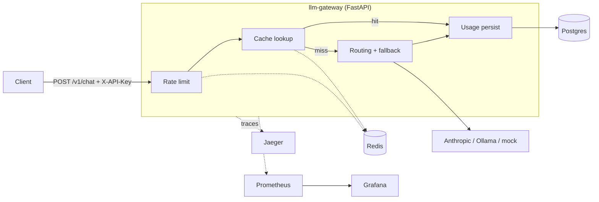

# llm-gateway


A local, portable LLM Ops platform: a unified gateway that routes requests across
multiple LLM providers, with caching, rate limiting, usage tracking and full
observability (metrics, logs, traces). Runs entirely with Docker Compose on a
single machine, with no cloud account needed.

## Features

- **Provider routing with fallbacks**: Anthropic, Ollama and mock providers behind a
  pluggable registry; each request can list ordered fallbacks tried on failure
- **Response caching**: Redis cache keyed on provider + model + prompt
- **Rate limiting**: per-API-key token bucket (10-request burst, 1 token/sec refill), Redis-backed
- **Usage tracking**: every request recorded in Postgres, queryable via `/v1/usage`
- **Observability**: structured JSON logs with trace IDs, Prometheus metrics, a
  provisioned Grafana dashboard, and OpenTelemetry traces in Jaeger
- **Tests and CI**: pytest suite that runs without any services; GitHub Actions runs
  Ruff and the tests on every push

## Architecture



## Quick start

```bash
docker compose up --build
```

Send a request (any non-empty `X-API-Key` works; there is no key management yet):

```bash
curl -X POST http://localhost:8000/v1/chat \
  -H "Content-Type: application/json" \
  -H "X-API-Key: demo-key" \
  -d '{"prompt": "hello"}'
```

Run it twice and the second response comes back with `"cached": true`.

| Endpoint | Description |
|----------|-------------|
| `POST /v1/chat` | Route a prompt to a provider (requires `X-API-Key`) |
| `GET /v1/providers` | List registered providers |
| `GET /v1/usage` | Aggregated requests, tokens and cache hits per provider/model |
| `GET /health` | Liveness check |
| `GET /metrics` | Prometheus metrics |

## Providers

| Provider | Notes |
|----------|-------|
| `mock` | Deterministic, no setup needed |
| `mock-failing` | Always errors; used to demo fallback routing |
| `anthropic` | Enabled when `ANTHROPIC_API_KEY` is set (see `.env.example`) |
| `ollama` | Local models; start with `docker compose --profile ollama up` |

Requests can list `fallbacks`, tried in order if the primary provider fails:

```json
{
  "prompt": "hello",
  "provider": "anthropic",
  "model": "claude-haiku-5-5",
  "fallbacks": [{"provider": "ollama", "model": "llama3.2:1b"}]
}
```

## Observability

| Tool | URL | Notes |
|------|-----|-------|
| Prometheus | http://localhost:9090 | Scrapes the gateway's `/metrics` |
| Grafana | http://localhost:3000 | `admin` / `admin` (local-dev default) or anonymous viewer |
| Jaeger | http://localhost:16686 | Distributed traces |

Grafana auto-provisions the Prometheus data source and the **LLM Gateway Overview**
dashboard on startup (see `grafana/`). No manual setup needed.

## Development

Run the gateway from a local venv (Redis and Postgres still run in Docker):

```bash
docker compose up -d redis postgres jaeger
python3 -m venv venv
source venv/bin/activate
pip install -r requirements.txt -r requirements-dev.txt
uvicorn app.main:app --reload
```

Lint, format and test:

```bash
ruff check .
ruff format .
pytest
```

Tests need no running services: Redis is faked, the database is in-memory SQLite,
and tracing is disabled.

## Roadmap

- [ ] Alembic migrations (replacing `create_all` at startup)
- [ ] Evaluation harness for prompt/latency regression checks
- [ ] API key management and auth on the usage endpoints
- [ ] Kubernetes manifests (Helm chart) and Terraform reference modules (design artifacts, not deployed)
